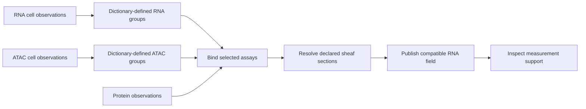

# A protocol over separately prepared assays

This protocol forms declared specimen groups from RNA and ATAC cell observations,
brings those results together with protein measurements, and resolves the
compatible and residual components of their declared assay interfaces. The
matrices are constructed examples, with separate source namespaces, dictionaries,
measurement units and evidence channels. The restrictions and comparison costs
are authored examples, not measured cross assay calibrations.

The protocol has five selected steps:



RNA and ATAC preparation can run concurrently. The binding waits for both
branches, selects their named outputs and the source protein assay, and publishes
a portable collection. Its aliases `rna`, `atac` and `protein` route the next
request. Each selected native study declaration, RFCXS archive and evidence
document is retained unchanged. The collection retains its binding request,
original byte owners, native namespaces and partition digests. Binding a collection
creates no identification between biological cells or source coordinates.

## Groups defined by scientific metadata

`design_aggregation` accepts an identity map or named groups on each dictionary
axis. A group has an exact coefficient and a conjunction of categorical
predicates. Each predicate lists the accepted values of one column. This supports
specimen, treatment, visit and declared cell type selections, or feature groups
from authored gene and pathway annotations. It does not infer any of these labels.

Here, the observation predicates select `specimen = S1`, one named `state`, and
`cell_type = malignant`. Two observations contribute to each of five states.
One stromal observation and one observation with a missing state remain in the
certificate as excluded source rows. The caller declares missing tokens, how to
handle unassigned rows, and whether overlapping membership is allowed. Missing
annotation values cannot satisfy a predicate. Overlap is available for general
linear maps; the count preserving mode requires disjoint observation groups and
unit coefficients.

The operation compiles those memberships into the existing exact aggregation
request. It reports every dictionary row, its original byte span, group
memberships, missing predicate columns, excluded status and the complete compiled
maps. Categorical indexes are built once for the queried columns; ordered row
lists implement the declared conjunctions. RexGraph's exact matrices and joined
CPU tiles carry out both numerical map actions. Zero valued measurements remain
observed, and missing nonzero dependencies remain missing after aggregation.

For a feature map `F`, assay matrix `X` and observation map `O`, the numerical
operation is `F X O^T`. Its explicit maps determine its meaning. In this example,
`F` preserves gene identities and `O` sums disjoint observation units, retaining
RNA UMI counts and ATAC fragment counts. General signed, overlapping or rational
maps instead retain a declared linear aggregate quantity.

## Assay interfaces and results

The grouped fields have the same numerical values as the complete
[paired assay example](../assay-sections/README.md), now obtained through separate
preparation branches. That example explains the occurrence coefficients, stalk
restrictions, metric and prepared projector in detail. Here the interface family
still retains three way relations, repeated cancelling occurrences, inactive
occurrences and zero magnitude occurrences. Equal feature labels in different
assays supply no restriction map; each map is explicitly declared in the query.

| State | Residual quadrance | Complete comparison |
|---|---:|---|
| before | 1420/51 | yes |
| after | 0 | yes |
| partial | 0 on the assessed domain | no |
| zero | 0 | yes |
| unobserved | 0 with no measured coordinates | no |

In the `before` state, the compatible first RNA and ATAC coordinates are both 3;
the measured inputs are 6 and 2. Their residuals are 3 and -1 in the declared
comparison metric. The `after` state already satisfies the supplied interfaces.
The partial and unobserved states report their unassessed constraints rather than
claiming a complete agreement. Publication retains full fields, missing support,
metrics, interfaces and generating inputs from all three assays.

GADGET admits the scientific declarations and manages artifacts and dependencies.
RexGraph C++ owns the exact field, sheaf, matrix, metric, preparation and CPU
services. A bound collection is an I/O construction; its declared interfaces
supply the subsequent relational comparison.

## Run and reproduce

Build GADGET as described in the [root README](../../../README.md), then run:

```sh
python3 examples/bioinformatics/staged-assays/replay.py \
  --binary build/gadget/gadget --out build/staged-assays
```

This directory includes the matrices, dictionaries, hashes, design queries,
complete pipeline and source bound model intent. The run retains each step's
request and result, the branch workspaces, native bound collection, compatible RNA
workspace and replay receipts. The script moves the generating workspaces, then
reopens the native bound collection and independently replays both grouped branches
and the compatible result from their retained inputs. `verification.json` lists
the replay outcomes and complete per state quadrances.

In `pipeline.json`, `bind_assays` explicitly names each input step, selected assay
and output alias. A binding may also select physical resources, including their
reference sequences. Its `links` list contains only authored relationships among
selected observation endpoints; links from previous collections are not inferred
or silently renamed. Native namespaces must remain distinct within a collection,
as required by the existing portable assay importer.

The selected `single_cell`, `rna_seq`, `atac_seq`, `chip_seq`, `spatial`,
`multi_omics` and `variants` profiles expose design aggregation and bindings.
Sequence protocols also expose bindings for selected resources and derived
assays. Custom protocols can combine any admitted method. Each plan executes only
its selected goals.

## Local model selection

`intent.json` binds each goal to the scientist's declared parameters. Its
`answer_contract` declares the exact question and the required observable:

```json
{
  "schema": "gadget.pipeline.answer.contract.v1",
  "question": "Inspect support of the published RNA compatible field. Select support.",
  "requirements": [
    {"id": "published-rna-support", "observable": "field_support", "bindings": ["support"]}
  ]
}
```

Here the binding fixes the assay, fields and all producing steps. It supplies the
scope of the question; identical names in other assays cannot substitute for that
binding. The registry assigns `field_support` to the coverage method, whose output
reports observed and missing coordinates. Purpose text cannot change this meaning.
The llama.cpp planner selects bindings and GADGET checks their complete prerequisite
closure:

```sh
build/gadget/gadget plan-recipes \
  --workspace build/staged-assays/generating-source/workspace.json \
  --intent examples/bioinformatics/staged-assays/intent.json \
  --model /path/to/local-model.gguf \
  --prompt 'Inspect support of the published RNA compatible field. Select support.' \
  --out build/selected-staged-assays
```

Selecting `support` includes both preparation branches, their binding and the
section analysis. RexGraph's finite constraint system checks every declared answer
requirement. The selected protocol executes through its native work graph. Before
publication, `answers.json` binds this requirement to all five field certificates,
retaining their actual source owners, queries, file hashes and result pointers.
The replay script runs this typed selection directly, without requiring model
weights, and verifies the pointers after moving the generating workspace.

A changed question requires a new researcher declaration. For a request for
population p values, declaring observable `population_p_value` yields an unsatisfied
contract: the shipped support method supplies no such result. GADGET returns the
missing requirement and a native subset minimal conflict instead of running it.
If a model requests clarification when compatible bindings exist, the result is
`selection_required` with the available bindings. No method runs on that response.
Untyped model proposals remain inspectable but do not automatically execute.
These checks establish coverage of the authored contract, not that a model has
correctly interpreted unrestricted prose.
